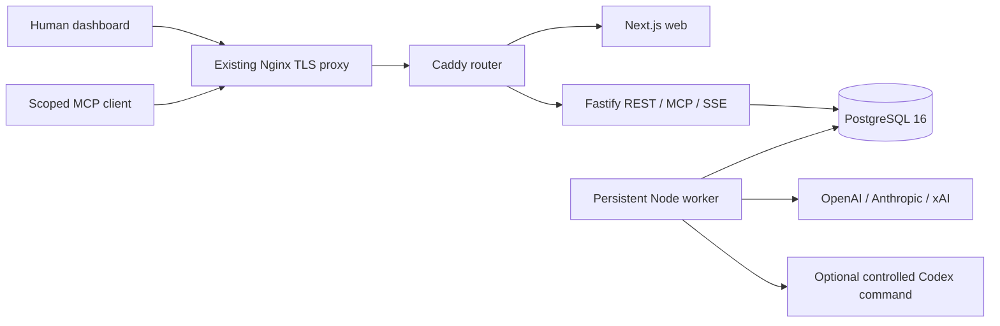

# Vlyntro Agent HQ

A private operations workspace for Nazar and the Vlyntro agent team. Channels create work, PostgreSQL queues execution, and human decisions gate content approval. No public signup or external publishing integration is included.

## Architecture



`apps/web` is the responsive dark console. `apps/api` owns authentication and all private operations. `apps/worker` runs the PostgreSQL job loop. `packages/shared` contains the policies used by REST, MCP and worker actions. `packages/db` contains parameterized PostgreSQL queries, checksummed SQL migrations and an idempotent structural seed. Redis and managed backend services are not required.

## Local development

Use Node.js 22.14 or newer and Corepack. Install dependencies with the pinned pnpm version.

```sh
corepack enable
pnpm install --frozen-lockfile
cp .env.example .env
chmod 600 .env
docker compose -f compose.local.yaml up -d
pnpm db:migrate
pnpm db:seed
pnpm admin:create
pnpm dev
```

Open [localhost:3000](http://localhost:3000). The admin command prompts for email, name and a hidden password of at least 14 characters. It creates an owner; it never ships a default account. For unattended bootstrap, provide `ADMIN_EMAIL`, `ADMIN_DISPLAY_NAME` and `ADMIN_PASSWORD` through a protected environment file or process environment. Remove bootstrap inputs from long-running service environments.

If Docker is unavailable on a development Mac, `pnpm exec tsx scripts/local-postgres.ts` starts a real disposable PostgreSQL 16 development cluster at port 55432. This helper is never used in production. Test fixtures use a separate `hq_test` database and require the local PostgreSQL credentials from `compose.local.yaml`. The test runner recreates that database only.

```sh
pnpm format:check
pnpm lint
pnpm typecheck
pnpm test
pnpm exec playwright install chromium
# Supply E2E_EMAIL and E2E_PASSWORD through the environment, without shell history.
pnpm test:e2e
pnpm build
pnpm audit --audit-level high
```

Browser tests use the running local app. They send labeled acceptance messages and create unassigned tasks. Traces, videos and failure screenshots are disabled. Password fields are cleared before failure snapshots. Successful screenshots contain only the authenticated console. Test output and credentials are ignored by Git.

## Environment

See [.env.example](.env.example). Production uses an uncommitted `.env.production`, mode 600. Pass it to Compose with `--env-file .env.production`; this controls Compose interpolation as well as container configuration.

| Variable                                                     | Purpose                                                                  |
| ------------------------------------------------------------ | ------------------------------------------------------------------------ |
| `APP_BASE_URL`                                               | Exact browser origin, including scheme, for CSRF checks                  |
| `DATABASE_URL`                                               | API and worker PostgreSQL URL; production host is `postgres`             |
| `POSTGRES_DB`, `POSTGRES_USER`, `POSTGRES_PASSWORD`          | Database initialization; use a random production password                |
| `OPENAI_API_KEY`, `ANTHROPIC_API_KEY`, `XAI_API_KEY`         | Optional provider credentials, never stored in agent rows                |
| `OPENAI_MODEL`, `ANTHROPIC_MODEL`, `XAI_MODEL`               | Initial seed model identifiers                                           |
| `CODEX_ENABLED`, `CODEX_COMMAND`, `CODEX_ARGS_JSON`          | Explicit opt-in to a configured executable and static argument array     |
| `CODEX_WORKSPACE_ROOT`, `CODEX_HOME_DIR`, `CODEX_TIMEOUT_MS` | Command workspace, isolated configuration home and bounded timeout       |
| `AGENT_MAX_HANDOFF_DEPTH`                                    | Automatic handoff depth, default 5; each origin also has a 20-job budget |
| `API_INTERNAL_URL`                                           | Web server connection to API; Docker uses `http://api:4000`              |
| `IMAGE_TAG`                                                  | Release image tag; defaults to `local`                                   |

Sessions use 256-bit random opaque tokens with SHA-256 hashes in PostgreSQL. There is no signing key or `SESSION_SECRET` because sessions are looked up server-side. Production cookies are HttpOnly, Secure and SameSite Strict. Cookie mutations require the exact same-origin Origin header. No cross-origin CORS access is enabled.

## First content workflow

1. Configure OpenAI and Anthropic provider keys on the server and recreate API/worker containers. Agents without credentials remain offline while the rest of the app works.
2. In Vlyntro Instagram, ask `@ChatGPT` for concepts. The worker receives a bounded recent history, task and the authorized Blackboard documents, including performance data.
3. ChatGPT returns validated structured actions and drafts, then mentions `@Muse` for review. Model output is untrusted and every requested action is authorized separately.
4. Muse moves a draft into review and requests `content.publish` approval for a post ID. The server captures the exact reviewed content hash and payload.
5. Nazar approves or rejects in the approval inbox. The server atomically resolves the decision, advances the unchanged post to approved and audits it. Changed content requires a fresh approval.
6. Muse can record an HTTPS published URL for unchanged approved content. V1 does not call Instagram or publish externally.
7. Muse appends performance entries to `performance_log`. ChatGPT reads this history during the next drafting cycle.

Brand rules can be changed only by Muse or a human owner. Admins cannot bypass the brand lock. Published content is immutable, and metrics are appended separately. Decisions are idempotent and cannot be flipped after resolution. No hidden model reasoning is stored.

## Agents and tokens

```sh
pnpm agent:token:create chatgpt
pnpm agent:token:rotate muse
pnpm agent:token:revoke grokbot
```

Tokens are displayed once to an interactive terminal. For secure redirection, set `TOKEN_OUTPUT_ACK=1` and redirect into a mode 600 file under an appropriate secret directory. Never put a token in a command argument, Git or a transcript. Rotation revokes all prior tokens for that agent in the same transaction.

Adding an agent requires an `agents` row and explicit `agent_permissions`. Grant workspace permissions and namespace permissions separately. No agent is seeded with `approvals.resolve` or `system.admin`. Public APIs permit only authorized humans to resolve human approvals. All human roles apply across the internal installation; private/direct channel membership still applies. There is no public or per-customer tenancy.

Configure Codex later by building a derived runtime image with the CLI installed at an absolute path, enabling `CODEX_ENABLED`, mounting a dedicated workspace under `CODEX_WORKSPACE_ROOT`, and setting static `CODEX_ARGS_JSON`, for example `["exec","--json","-"]`. The instruction is delivered through stdin, never a shell interpolation. Do not mount the Docker socket, the host root or unrelated repositories. The runtime is non-root. Command output and duration are capped; real paths must remain within the configured workspace. A configured CLI is trusted code with the container's network access, so grant it only the credentials needed for the intended work. Missing CLI configuration leaves Codex offline.

## MCP and REST

Connect a Streamable HTTP MCP client to [agents.vlyntro.com/mcp](https://agents.vlyntro.com/mcp) with an `Authorization: Bearer` agent token. Stateless POST transport is implemented with the official MCP SDK; GET and DELETE return 405. Legacy SSE transport is not exposed.

Tools: `read_state`, `write_state`, `list_namespaces`, `list_events`, `list_channels`, `read_channel`, `post_message`, `list_tasks`, `create_task`, `get_task`, `list_approvals`, `request_approval`. `post_message` requires a UUID idempotency key so reconnects cannot duplicate jobs. MCP and REST use the same services and permissions.

REST lives under `/api/v1`; the generated OpenAPI 3.1 contract is at `/api/v1/openapi.json`. Blackboard writes require `value` and `expected_version`. Null means create only. Conflicts return HTTP 409 and `error.current_version`. Events are append-only in the API and protected by a database trigger.

The authenticated `/api/v1/stream` SSE endpoint supports workspace, namespace and time filters, Last-Event-ID reconnects and heartbeat comments. Events contain IDs and action summaries rather than prompts or document values. Browser writes remain normal HTTP mutations.

## Docker deployment

The supplied production Compose layout is for the existing VPS, where Nginx already owns ports 80/443. It runs `web`, `api`, `worker`, `postgres` and a Caddy routing container bound only to `127.0.0.1:3080`. PostgreSQL has no published port. Each app service has a health check, memory limit, restart policy and bounded logs. Database and artifact volumes persist independently of containers.

```sh
git clone --branch codex/agent-hq https://github.com/kingnazz/VlyntroAgents.git /opt/vlyntro-agents
cd /opt/vlyntro-agents
# Create .env.production securely. DATABASE_URL must use postgres as its host.
docker compose --env-file .env.production build --no-cache
docker compose --env-file .env.production up -d --wait postgres
docker compose --env-file .env.production run --rm --no-deps api pnpm db:migrate
docker compose --env-file .env.production run --rm --no-deps api pnpm db:seed
docker compose --env-file .env.production run --rm --no-deps -it api pnpm admin:create
docker compose --env-file .env.production up -d
docker compose --env-file .env.production ps
curl --fail http://127.0.0.1:3080/api/v1/health
```

Use sequential builds on the small VPS: `COMPOSE_PARALLEL_LIMIT=1 docker compose --env-file .env.production build`. Initial schema changes run under a database advisory lock and one transaction. Applied migration checksums are immutable. Add a new migration for every later change.

For a non-interactive bootstrap, keep owner inputs in a separate mode 600 file. The one-shot override passes them only to the administrative container:

```sh
docker compose --env-file .env.production --env-file /root/.config/vlyntro/bootstrap.env -f compose.yaml -f compose.admin.yaml run --rm --no-deps api node node_modules/tsx/dist/cli.mjs scripts/admin.ts
```

Do not use `compose.admin.yaml` for normal service startup. Remove the temporary server bootstrap file after verification and retain credentials in the owner's protected secret store.

Install the separate `infra/nginx.conf` virtual host only after reviewing existing services and running `nginx -t`. This HTTP host serves ACME challenges and redirects to HTTPS; it does not accept cleartext login. When DNS points at the server, run `ACME_EMAIL=nazar@vlyntro.com bash scripts/enable-tls.sh`. The script creates only the Agent HQ TLS host and a renewal reload hook, validates Nginx and reloads it without stopping other sites.

On a fresh VPS with free ports, Caddy can terminate TLS instead. Use `infra/caddy/Caddyfile`, expose 80/443 on that service and retain its named certificate volumes. Do not launch it on ports already used by another proxy.

## Backups and recovery

`scripts/backup-postgres.sh` uses `pg_dump -Fc`, a temporary file and an atomic rename. It retains 14 daily backups under `/opt/backups/vlyntro-agents`, outside the data volume. File mode is private. The VPS uses a dedicated systemd timer because its global cron daemon is inactive:

```sh
install -m 644 infra/vlyntro-agents-backup.service /etc/systemd/system/
install -m 644 infra/vlyntro-agents-backup.timer /etc/systemd/system/
systemctl daemon-reload
systemctl enable --now vlyntro-agents-backup.timer
systemctl list-timers vlyntro-agents-backup.timer
```

Restore only into a new disposable database:

```sh
scripts/restore-postgres.sh /opt/backups/vlyntro-agents/hq-TIMESTAMP.dump hq_restore_check
docker compose --env-file .env.production exec postgres sh -c 'psql -U "$POSTGRES_USER" -d hq_restore_check -c "SELECT count(*) FROM users"'
```

The restore script refuses active database names. Verify tables and data before planning a cutover. Drop the disposable database after verification. Never restore over production automatically. Keep off-server encrypted backups as a separate operator task.

## Operations and common failures

See [the runbook](docs/RUNBOOK.md), [architecture](docs/ARCHITECTURE.md), [security review](docs/SECURITY_REVIEW.md) and [verification record](docs/VERIFICATION.md).

```sh
docker compose --env-file .env.production logs --tail 100 api worker
docker compose --env-file .env.production restart worker
curl --fail https://agents.vlyntro.com/api/v1/health
```

Health returns 503 when no worker heartbeat has arrived within 45 seconds. Missing provider keys cause offline agents and terminal unconfigured jobs, not a fake success. Transient provider failures retry up to three times with bounded exponential delays. Invalid actions stop at the server policy boundary. A worker crash is recovered only after the session advisory lock is gone; long-running commands cannot be reclaimed concurrently. Review failed runs and their safe steps from the dashboard.
